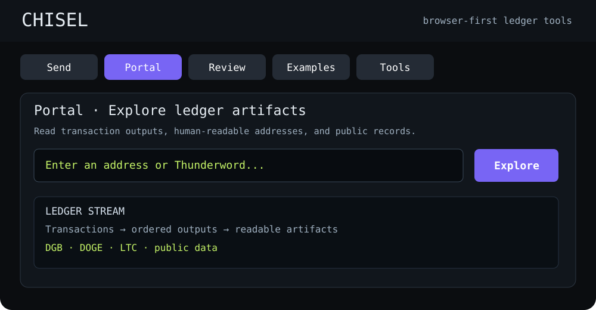

# Chisel

**Use Chisel in your browser:** explore public ledger artifacts, construct transactions, inspect outputs, and use the QR and identity tools. No framework installation is required to open the hosted application.

<p align="center">
  <a href="https://johnrigler.github.io/chisel/"></a>
</p>

<p align="center"><a href="https://johnrigler.github.io/chisel/"><strong>▶ OPEN CHISEL</strong></a> · <a href="https://johnrigler.github.io/chisel/?mode=portal">Explore the Portal</a></p>

*Illustrative interface preview, not a live screenshot. Open the hosted Chisel application for the actual interface.*

Chisel is a browser-first toolkit for reading and preserving small blockchain artifacts. **Portal** is the primary public reader; **Send**, **Review**, **Examples**, and **Tools** expose other workflows. It is designed for static hosting, including GitHub Pages and IPFS. Creating or broadcasting transactions may require keys, UTXOs, network connectivity, and supported chain services. You do not need a key merely to inspect public records.

## Share text or a link into Chisel

Install the [Mogwai share widget](https://johnrigler.github.io/mogwai/app/)
in Chrome on Android or ChromeOS. Use a system share chooser that lists
Mogwai. YouTube's own social-network panel is a separate menu. The widget
keeps shared links and text for review before opening Chisel's Send screen. OP_RETURN
ASCII uses a multiline field so incoming paragraph breaks remain visible.
The receiver and setup notes live in
[Mogwai](https://github.com/johnrigler/mogwai/tree/main/app).

The handoff is `?mode=send#opreturn=<URL-encoded-text>`; `opreturn` also works
as a query parameter for tools such as Termux URL openers. An optional
`record=<URL-encoded-JSON>` fragment carries `chisel-shared-record-v1`:
`opReturnText`, `summary` (including the same `opReturnText`, title, primary
URL and `mediaCards`), and `metadata`. The record is limited to 65,536 UTF-8
bytes and must match the imported text exactly. Both markers are consumed
after loading. Existing text-only senders remain compatible.

Send shows an expanded **Record preview** immediately above **SEND**, using
Portal's stream-row and media-card renderer. It includes the picture, full
title, channel, source/retrieval details, actual OP_RETURN HEX and byte count,
current recipients, requested fee and IPFS field. The complete received
record is inspectable as JSON. Editing the content removes the previous
share's metadata; changing currency, recipients or fee updates the preview.
The preview has no fabricated TXID, inputs, change or confirmation time.

Only the supplied text enters the transaction draft. Imported metadata cannot
set keys, chain, recipients or fees, and previewing does not sign, broadcast,
save to FileProxy or add a pending record to the Portal stream. Linked pictures
and metadata are external display data, not extra OP_RETURN bytes; they can
be retrieved again from the ledger's URL when reading the transaction. Chain
payload limits and the existing built-transaction review still apply.

Mogwai bounds its outgoing text/link payload to **80 UTF-8 bytes**, retaining
oversized receipts for editing and keeping metadata outside that byte budget.
Closed Portal rows show media metadata and a small picture, including saved
Netflix/page metadata. Opening the record puts the large picture first, above
transaction details and optional drawers. Both sizes use the same artwork;
the original media destination remains the click target. Explicit image fields
can reference extensionless HTTP(S) IPFS gateways without treating a Netflix
watch or title page as image bytes.

After an accepted broadcast, Chisel switches to Portal and adds the locally
decoded transaction at the top immediately, retaining the reviewed media.
Until the ledger observes it, the record uses navy text. Background reads query the selected
chain's live node/provider directly; its exact raw bytes and computed TXID
must match the sent transaction before the same row turns black.
Broadcast replies, local/FileProxy caches and decoded JSON do not establish
this status. A mempool read establishes visibility, not block confirmation.
Failed reads retain navy text and retry. Submitted and observed records use
the same layout, without awaiting/seen labels or status panels. Discovery
merges by chain/TXID, retaining fetched amounts and timestamps alongside the
reviewed media when a later receipt check updates the row.

Portal 2.8.15 restores the public account's cached history immediately, then
queries its live address history. Pending sends lead the feed, followed by
transactions in newest-first order. Confirmation timestamps from BlockCypher
and Esplora are read directly. Address-history pagination continues past the
first 50/25 transactions; the UI's page size is not a history limit. Recent
pages remain visible if an older request fails, and later refreshes retry it.
After a complete pass, refreshes can stop at a known confirmed transaction.

While Portal is visible, live history refreshes every two minutes. Returning
to Portal or focusing it refreshes when the last check is over a minute old.
These intervals use the existing `liveLedgerRefresh*` configuration fields.
Refreshes merge rows without resetting the open record or page. Public account
summaries use localStorage rather than cookies; a browser quota error preserves
the previous snapshot. Full transaction JSON and address-stream manifests use
the configured FileProxy's existing cache paths when it is available. Neither
cache establishes independent ledger observation for a submitted receipt.

Pagination follows the providers' documented cursors:
[BlockCypher full address](https://github.com/blockcypher/docs/blob/master/source/includes/_address.md)
and [Esplora address history](https://github.com/Blockstream/esplora/blob/master/API.md#addresses).

The last 20 local public receipts are kept in this tab's session storage,
bounded to one million JSON characters. This contains signed transaction
bytes and display metadata, with no WIF, account object, signing context or
transport credentials. Reload reconstructs the records and checks them again;
it does not trust a saved status claim. This temporary history belongs to the
tab's session (including a browser-restored session); regular Portal ledger
discovery remains independent.

## W42 review fixes

Send now verifies input amounts from previous transaction bytes, checks a bounded fee, and asks you to review the actual outputs before signing. Normal wallet and identity signing uses locally bundled Noble. See the [technical review response](docs/SECURITY_REVIEW_2026_W42.md) for the fixes, tests and trust limits.

## What it does

A transaction output can be more than a payment. An address can carry readable structure. An amount can carry a small code. An OP_RETURN can carry text. A transaction can become a public note, breadcrumb, receipt, ritual, or searchable index.

Chisel keeps public ledger material separate from local interpretation. The transaction remains public. Local notes, categories, fixes, feed imports, and indexes live in the local Chisel datastore.

## Design style: small primitives, loose coupling

Chisel is built with the same bias that makes Unix useful: use the smallest primitive that already does the job, keep interfaces inspectable, and compose tools instead of hiding everything behind one framework.

The recurring pattern is:

```text
ledger primitive -> small representation -> replaceable tool -> another transport or store
```

Examples already present in Chisel include readable unspendable addresses, amount-level ASC codes, OP_RETURN, ordered transaction outputs, static JSON fixtures, QR labels, local browser signing, IPFS hydration, M64, and small shell-oriented helper tools.

The project deliberately asks questions such as:

- What can the ledger already represent without adding another database?
- What can the browser already do without a hosted application backend?
- What can Bash already parse and expose instead of writing another parser?
- What can a signed transaction already prove regardless of how it was transported?
- What is the minimum additional machinery required to recover, relay, inspect, or rebuild an artifact?

This also means transport should not define trust. A signed transaction or signed Chisel object can in principle move over HTTP, WebRTC, QR codes, Bluetooth, LoRa, removable media, or another relay. The blockchain only cares that the serialized object is valid when it finally reaches a node. LoRa and similar low-bandwidth systems are therefore interesting as relay/control planes: a gateway can do the heavy blockchain work while the radio side carries only a transaction, txid, selected result, compact proof, or other narrow message.

The same idea applies to infrastructure economics. Gateways, full nodes, chain watchers, proof generators, IPFS pinning, hydration, indexing, and store-and-forward services perform real work. Those services can be paid using an existing cryptocurrency without making payment itself the definition of truth or identity.

## M64 and symbolic representations

M64 is moving toward a language-neutral compact representation rather than merely a text compressor. Repeated language and protocol symbols can be interned in a shared dictionary, including an EVM/Solidity-backed dictionary, while artifacts carry compact references to those symbols.

Bash is a useful experiment because Chisel already uses shell-like chord forms and small functions. Bash can parse Bash itself; `declare -f` can emit a normalized function representation, after which tiny checksum/ASC functions, symbolic extraction, and M64 can operate on the result. Colon records can remain inert data while executable behavior stays in ordinary Bash functions. Nested function definitions can express a practical tree even though Bash itself does not provide lexical function scope.

This is a research direction, not a claim that arbitrary Bash is already serialized on-chain. The useful target is a deliberately small, inspectable symbolic form that can hydrate into Bash, JavaScript, or another language-specific representation.

## secp256k1 signing: Noble migration

Chisel is migrating its browser-local secp256k1 primitive to `@noble/secp256k1` behind an implementation-neutral boundary. The tested migration branch has now been merged into `main`.

The migration keeps Chisel's transaction formats, WIF handling, address derivation, sighash construction, script construction, and browser-first distribution model unchanged. `chisel.secp256k1.js` defines the common boundary, and `chisel.secp256k1.noble.js` adapts Noble to it.

The normal browser path still retains the vendored `elliptic` signer as the legacy/default compatibility path and parity guard. It should not be deleted until a pinned standalone browser build of Noble is wired into the ordinary static/file:// distribution and the main path no longer loads or calls elliptic. See `docs/SECP256K1_MIGRATION.md`.

## Orientation for colleagues

Start with the origin bridge before touring the code:

- `docs/origin.md` explains the vanilla-JS signing decision, the historical elliptic bridge, and the current move to Noble, then maps the 2020 white paper into the current Chisel implementation.
- `docs/SECP256K1_MIGRATION.md` documents the Noble boundary, parity tests, browser test harness, and remaining production cutover gate.
- `docs/origin-print.html` is the printable HTML version for meetings and page-layout checks.
- `docs/refactor-phases.md` defines the low-risk sequence for cleaning up the project without touching signing or broadcast paths too early.
- `docs/NEXT_DEVELOPMENT.md` is the active development sequence: regression floor -> M64 v3 protocol -> JavaScript adapter boundary -> shared ledger dictionary -> measurements -> recursive Chisel rebuild.

The short version: Chisel reads and writes ledger-native artifacts. A UTXO transaction can carry meaning through ordered outputs, readable unspendable addresses, optional OP_RETURN payloads, and amount-level codes. Portal should be the main reader. fileProxy, bunOven, keeperBun, label tools, QR tools, and other helpers are satellites.

Portal is now static-first: `data-bundled/portal-starter.js` preloads the known public records immediately, `data-bundled/manifest.json` and `data-bundled/index/portal.index.json` describe the same dataset for validation/refresh, and live ledger searches merge newer records without clearing the stream. `bun`, `deno`, `fileProxy`, local nodes, and import scripts remain authoring/publishing tools. They should not be required for a public visitor opening the GitHub/IPFS/rigler.org build.

## Current development direction

Do not treat general cleanup as the main project. Put a small fixture-driven regression floor under existing behavior, then make M64 a stable language-neutral protocol. M64 v2 is the implemented staging format; v3 should replace embedded dictionary snapshots with durable dictionary references while preserving v2 hydration compatibility.

The intended order is documented in `docs/NEXT_DEVELOPMENT.md`. In particular, avoid broad changes to signing, serialization, fee selection, UTXO selection, or broadcast behavior until known-value fixtures cover those paths.

## Proposed BSV extension

[BSV support direction](docs/BSV-SUPPORT-DIRECTION.md) records the proposed
Bitcoin SV read/publish extension and an unverified DNS-like naming research
lead. This is Chisel work, separate from the current Commons narrative.
The inspected main branch does not establish working BSV support; the first
task is a raw-transaction read-path feasibility check.

## v2.7.15c Base57 image capture

The V1 image workflow is available from Etch’s `BASE57 IMAGE` button and from `tools/imageEncoder/`.

- The selected image stays in the browser; Chisel does not upload it.
- The source is resized onto an adjustable raster, then Top/Bottom/Left/Right margins select a movable 26-column box of up to 100 rows using the existing `b57.json` 57-color palette.
- A V1 parameter line accepts `Top,Bottom,Left,Right` directly. For `42,134,150,48` on a square source, it recreates the 224×224 raster and 26×48 Lou Reed capture.
- V1-compatible resize smoothing is the default. Preview scale is display-only and defaults to 5.
- Every ordered row becomes a checksum-valid Digibyte address whose layout is `S*` + 26 palette glyphs + 6 checksum glyphs.
- The first form is V1-compatible `SN`. Alternate decoder-safe `S*` prefixes and checksum variants keep identical pixel rows unique without changing their Portal rendering.
- `WRITE TO CHISEL ETCH` replaces the current recipient list with the ordered 0.0000546 DGB image outputs for review and signing.

The browser self-test includes the V1 Mogwai fixture address `SNMMMBQXiiiiiisrrrriiXQBBMMM12AD3f` and verifies the encoder → Etch → Portal row contract.

## v2.7.1 Dogecoin local import

This build imports the uploaded Bun jist Dogecoin feed into Chisel's local Portal path.

Parsed feed:

- 50 Dogecoin output row(s)
- 41 transaction fixture file(s)

The uploaded tree has `data` as a symlink to `/home/john/daisy/2026/chisel-data`. I preserved that symlink. The bundled Dogecoin seed is under `data-bundled/`, and fileProxy now reads both `data/transactions` and `data-bundled/transactions`.

To merge the same feed into the traditional datastore behind the `data` symlink, run:

```bash
python3 tools/fileProxy/proxy.py
bun tools/bunOven/import-jist-to-fileProxy.js data-bundled/imports/dogecoin/bun-jist-dogecoin-20260623.jsonl
```

To replace the Dogecoin store first:

```bash
bun tools/bunOven/import-jist-to-fileProxy.js data-bundled/imports/dogecoin/bun-jist-dogecoin-20260623.jsonl --replace
```

## Local datastore

The normal fileProxy datastore shape is:

```text
data/
  transactions/<coin>/*.json
  index/transactions.index.json
  imports/<coin>/*.jsonl
  chords/<coin>/*.chord
```

This patch also includes a read-only bundled seed:

```text
data-bundled/
  transactions/dogecoin/*.json
  index/transactions.index.json
  imports/dogecoin/bun-jist-dogecoin-20260623.jsonl
  chords/dogecoin/bun-jist-dogecoin-20260623.chord
```

## Portal

Start fileProxy:

```bash
python3 tools/fileProxy/proxy.py
```

Open `index.html` in Portal mode. The included config sets:

```json
{
  "autoLoadLocalTransactions": true,
  "autoLoadConversationStreams": false,
  "portalFilterDogecoin": true
}
```

That avoids remote Thunderword fetching on page load and shows the local/bundled Dogecoin import first.

## bunOven and fileProxy

`bunOven` should consume fileProxy. The new endpoint is:

```text
POST /import-jist-feed
```

Accepted body:

```json
{
  "coin": "dogecoin",
  "mode": "merge",
  "text": "{...jsonl...}"
}
```

`mode` can be `merge` or `replace`. Merge is the safe default. Replace is useful when a bad scan polluted the local Dogecoin folder.

## Chords

Chisel keeps a chord rendering of output rows:

```bash
dogecoin() {
  : 9sGoTTAxLiGHTxGoTTAxLiGHTzzz7g5ZcF 0.00039692;
  : DCxxxxFiNNEGANSxWAKEzzzzzzzzyYeZHb 1.00037497;
}
```

The chord is a local view, not a replacement for the transaction fixture JSON.

## Literal handling

The Dogecoin data is literal output data from the uploaded Bun jist feed. It is not reconstructed from printed Joyce and typos are not repaired.

## ETHDenver 2027 coordination

See [the project-specific ETHDenver / Zorkmid notes](docs/ethdenver-zorkmid-integration.md) for the proposed physical dartboard demonstration, conference materials, optional Zorkmid/ Base integration, and delivery gates. These are plans, not claims that a token, venue, or showcase is live.

## CertLedger / Daisy evidence checkpoints

The [CertLedger hash review](tools/certLedger/index.html) accepts a full SHA-256
or the hash-only draft from Commons artifact intake. It prepares `sha256:` plus
the 64-digit digest in ASCII (71 bytes), with the explicit LMx/CertLedger tag,
then passes the reviewed plan into the existing Send artifact loader.
Source PDFs and correspondence are not required by Chisel. Loading a plan does
not sign or broadcast it. [Handoff contract](tools/certLedger/README.md).

Project Jupiter and other CertLedger-style investigations now primarily
hold evolving source records in yearly Daisy repositories. Chisel remains
an **optional** ledger-anchoring tool for selected, frozen and reviewed
SHA-256 evidence manifests, not a web-source monitor or a source of legal
truth. See [Proposed manifest and transaction-receipt contract](docs/CERTLEDGER-ANCHOR-MANIFEST.md).
No wallet, signing, send or broadcast behavior changes are implied.

## CTP500 thermal printer

[Open the key and image printer](https://johnrigler.github.io/chisel/tools/keyPrint/index.html?v=20261017-menu1)
for direct phone BLE printing, Chromebook Serial printing, or PNG export.
This replaces the former InstaPrint handoff with the verified browser transport
and retains scanner handoffs. Connect once per page and press Print to send the displayed receipt or image.
See [the printer tool guide](tools/keyPrint/README.md).

[Open the diagnostic receipt](https://johnrigler.github.io/chisel/ctp500-test.html?v=20261016-ble3).
Android Chrome uses BLE; Chromebook/desktop can use Web Serial. The page
renders the test and measured diagnostic footer locally, sends both to the printer,
and lets you save the receipt as a PNG.
See [printer setup, confirmed tests, and transfer timing](ctp500.md).

## Litecoin provider failover

The Send provider list is tried in its configured order. Errors, unsupported
methods, invalid responses, and timeouts advance to the next provider; the first
success stops the operation. A read has a 10-second per-provider limit and a
broadcast has a 12-second limit. Stalled requests are aborted. Explicitly
cancelled operations stop instead of trying another provider.

Every broadcast attempt uses the same signed transaction bytes. Failover does
not rebuild, re-sign, or change the fee. If every provider fails, the error retains
the attempts and identifies a potentially unknown broadcast outcome. An empty,
valid UTXO list is a successful read; it is not treated as an endpoint failure.
Explicit provider cross-checks still query every listed provider.

The mainnet defaults are `litecoinspace,blockcypherLitecoin,blockchairLitecoin`.
Blockchair now supplies UTXOs and broadcasts as well as transaction lookups.
Existing custom lists remain unchanged. `tests/provider-failover.test.mjs` covers
ordered fallback, network mismatches, missing methods, timeouts/cancellation,
identical broadcast bytes, complete failure, and the native adapters with mock
HTTP responses. It is included in the regression workflow and never broadcasts.

## Native eCash notes in Zorkmid

The [Zorkmid Chisel view](https://johnrigler.github.io/lantern/world.html#view=etch)
uses the new, separate `chisel.ecash.js` module for native eCash mainnet notes and
IPFS URIs. It signs locally with Bitcoin ABC's library, reviews the fee/change,
and requires an explicit broadcast action. See [ECASH.md](ECASH.md) for protocol,
limits, SDK provenance, and tests. The existing legacy signer is unchanged.
